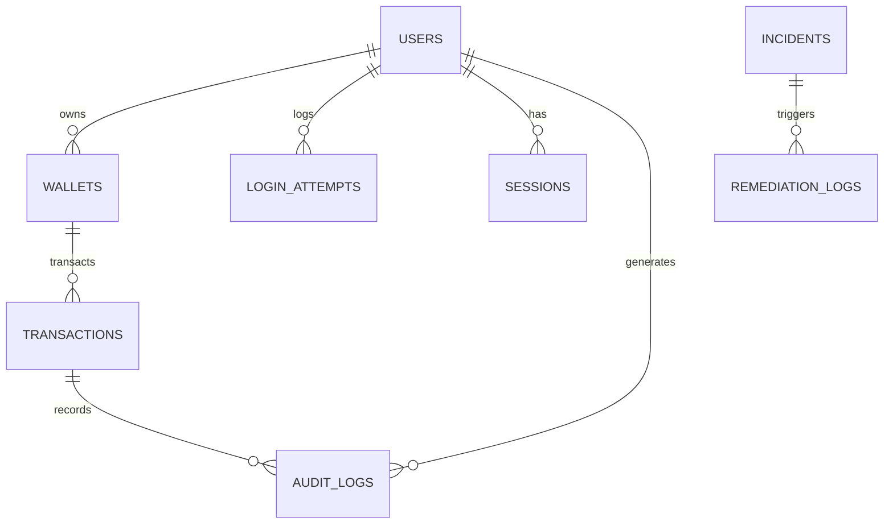

# 🗄️ Service Base de Données — EPSI Pay (PostgreSQL 15)

Ce répertoire constitue le socle de données de la plateforme **EPSI Pay** dans le cadre du projet **RESILIENCE-ALPHA**.
Il regroupe le schéma Prisma, les scripts de seed/migration et le **dictionnaire de données officiel** du projet.

---

## 📐 Diagramme Entité-Relation (ERD)



---

## 📋 Conventions & Standards de Conception

* **Moteur & Version** : PostgreSQL 15 (conformité ACID stricte pour transactions financières).
* **Identifiants (Clés primaires)** : UUID v4 (`String` format UUID) pour garantir l'unicité globale sans collision et éviter l'énumération séquentielle.
* **Précision monétaire** : Type `Decimal(12, 2)` (évite les erreurs d'arrondi des nombres à virgule flottante IEEE 754).
* **Horodatage** : Tous les champs `createdAt` et `updatedAt` sont stockés en UTC avec timezone (`TIMESTAMPTZ`).
* **Concurrence & Résilience** : Gestion des verrous optimistes (`version` sur `wallets`) et clés d'idempotence (`idempotencyKey` sur `transactions`).

---

## 📖 Dictionnaire de Données Officiel

---

### MODULE 1 : Authentification & Sécurité (Cible Attaque Brute Force)

#### 1. Table `users`

> **Rôle :** Stocke les comptes utilisateurs, leurs privilèges d'accès et l'état de sécurité de leur compte lors d'attaques.

| Champ | Type SQL | Contraintes | Description métier | Sécurité & Conformité | Rôle RESILIENCE-ALPHA |
| :--- | :--- | :--- | :--- | :--- | :--- |
| `id` | `UUID` | **PK**, Not Null | Identifiant unique de l'utilisateur. | Non sensible | Clé de référence interne. |
| `email` | `VARCHAR(255)` | **Unique**, Not Null | Adresse e-mail servant d'identifiant de connexion. | Donnée Personnelle (RGPD) | Cible lors des attaques par credential stuffing / brute force. |
| `passwordHash` | `VARCHAR(255)` | Not Null | Empreinte du mot de passe haché (bcrypt/argon2). | Secret sensible | Ne transite jamais en clair. |
| `name` | `VARCHAR(255)` | Nullable | Nom complet ou raison sociale. | Donnée Personnelle | Affichage dashboard. |
| `role` | `ENUM` | `CLIENT`, `MERCHANT`, `ADMIN` (défaut: `CLIENT`) | Rôle applicatif et niveau d'autorisation. | Contrôle d'accès RBAC | Isole les marchands des clients. |
| `status` | `ENUM` | `ACTIVE`, `LOCKED`, `SUSPENDED` | État actuel du compte utilisateur. | DORA / NIS2 (intégrité) | Bascule sur `LOCKED` en cas de suspicion d'intrusion. |
| `failedLoginAttempts` | `INTEGER` | Défaut: `0` | Compteur de tentatives consécutives de connexion échouées. | Sécurité / Brute force | Incrémenté par le service `auth` lors de l'attaque. |
| `lockedUntil` | `TIMESTAMPTZ` | Nullable | Date/heure jusqu'à laquelle le compte est temporairement gelé. | Résilience | Permet le déverrouillage autonome post-incident. |
| `createdAt` | `TIMESTAMPTZ` | Défaut: `now()` | Date de création du compte. | Traçabilité | Audit d'ancienneté. |
| `updatedAt` | `TIMESTAMPTZ` | Auto-update | Date de dernière modification du compte. | Traçabilité | Détection de modifications suspectes. |

---

#### 2. Table `login_attempts`

> **Rôle :** Journalise chaque tentative de connexion. **C'est la source de données majeure alimentant le modèle de Machine Learning.**

| Champ | Type SQL | Contraintes | Description métier | Sécurité & Conformité | Rôle RESILIENCE-ALPHA |
| :--- | :--- | :--- | :--- | :--- | :--- |
| `id` | `UUID` | **PK**, Not Null | Identifiant de la tentative. | Non sensible | Indexation. |
| `attemptedEmail` | `VARCHAR(255)` | Not Null, Index | Adresse email brute saisie dans le formulaire lors de la tentative. | Traçabilité Cyber | Analyse des patterns d'attaque par dictionnaire / credential stuffing. |
| `targetUserId` | `UUID` | **FK** `users.id`, Nullable | Compte utilisateur ciblé s'il existe en base (`NULL` si email inconnu ou inventé). | Traçabilité | Permet de savoir quel compte précis était visé par l'attaquant. |
| `ipAddress` | `VARCHAR(45)` | Not Null, Index | Adresse IPv4 ou IPv6 du client distant. | Donnée sensible / Logs | **Détecte le PC Attaquant** pour blocage IP. |
| `userAgent` | `TEXT` | Nullable | Signature HTTP du navigateur ou outil d'attaque (ex: Hydra, Curl). | Audit Cyber | Utilisé comme feature discriminante par le modèle ML. |
| `isAuthenticated` | `BOOLEAN` | Not Null | `true` si les identifiants sont validés avec succès, `false` sinon. | Sécurité | Indicateur explicite de succès de l'authentification. |
| `failureReason` | `VARCHAR(100)` | Nullable | Motif (`INVALID_CREDENTIALS`, `LOCKED_USER`, `IP_BLOCKED`). | Audit | Analyse du comportement d'attaque. |
| `createdAt` | `TIMESTAMPTZ` | Défaut: `now()`, Index | Horodatage précis de la tentative. | Supervision | Calcul de la vélocité (requêtes/seconde). |

---

#### 3. Table `blocked_ips`

> **Rôle :** Liste noire dynamique des adresses IP malveillantes. **Alimentée directement par le moteur de remédiation autonome.**

| Champ | Type SQL | Contraintes | Description métier | Sécurité & Conformité | Rôle RESILIENCE-ALPHA |
| :--- | :--- | :--- | :--- | :--- | :--- |
| `id` | `UUID` | **PK**, Not Null | Identifiant de la règle de blocage. | Non sensible | Indexation. |
| `ipAddress` | `VARCHAR(45)` | **Unique**, Index | Adresse IP bannie du système. | Sécurité périmétrique | **Stoppe immédiatement le PC Attaquant.** |
| `reason` | `VARCHAR(255)` | Not Null | Explication du bannissement (`ML_ANOMALY_BRUTE_FORCE`, etc.). | Traçabilité | Justification de l'action pour le jury. |
| `blockedBy` | `VARCHAR(100)` | Défaut: `AUTO_REMEDIATION` | Entité ayant ordonné le blocage (`AUTO_REMEDIATION`, `WAF`, `ADMIN`). | Gouvernance / Audit | Prouve l'autonomie de la remédiation. |
| `isActive` | `BOOLEAN` | Défaut: `true`, Index | Indique si le blocage est actif. | Résilience | Permet la levée temporaire ou définitive. |
| `blockedAt` | `TIMESTAMPTZ` | Défaut: `now()` | Date et heure du bannissement. | Métrique | Utilisé pour calculer le MTTR (temps de réponse). |
| `expiresAt` | `TIMESTAMPTZ` | Nullable | Date d'expiration du bannissement temporaire. | Résilience | Évite le blocage perpétuel d'adresses dynamiques. |

---

#### 4. Table `sessions`

> **Rôle :** Maintien et révocation des sessions de connexion actives.

| Champ | Type SQL | Contraintes | Description métier | Sécurité & Conformité | Rôle RESILIENCE-ALPHA |
| :--- | :--- | :--- | :--- | :--- | :--- |
| `id` | `UUID` | **PK**, Not Null | Identifiant de session. | Non sensible | Clé primaire. |
| `userId` | `UUID` | **FK** `users.id`, Cascade | Propriétaire de la session. | Contrôle d'accès | Révocation en cascade si compte bloqué. |
| `tokenHash` | `VARCHAR(255)` | **Unique**, Index | Empreinte hachée du jeton de rafraîchissement. | Secret sensible | Protection contre le vol de session. |
| `ipAddress` | `VARCHAR(45)` | Nullable | Adresse IP d'ouverture de session. | Sécurité | Détection de vol de session (changement d'IP). |
| `userAgent` | `TEXT` | Nullable | User-Agent d'ouverture. | Sécurité | Empreinte d'environnement. |
| `isValid` | `BOOLEAN` | Défaut: `true` | Statut de validité du jeton. | Sécurité | Révocation immédiate post-incident. |
| `expiresAt` | `TIMESTAMPTZ` | Not Null | Date de fin de validité de la session. | Sécurité | Expiration automatique des accès. |
| `createdAt` | `TIMESTAMPTZ` | Défaut: `now()` | Date de connexion. | Audit | Historique des sessions. |

---

### MODULE 2 : Comptes & Portefeuilles (Wallets)

#### 5. Table `wallets`

> **Rôle :** Représente les comptes de paiement hébergeant les fonds des clients et commerçants.

| Champ | Type SQL | Contraintes | Description métier | Sécurité & Conformité | Rôle RESILIENCE-ALPHA |
| :--- | :--- | :--- | :--- | :--- | :--- |
| `id` | `UUID` | **PK**, Not Null | Identifiant unique du portefeuille. | Non sensible | Référence de routage financier. |
| `userId` | `UUID` | **FK** `users.id`, Restrict, Index | Utilisateur propriétaire du portefeuille. | Isolation stricte | Un utilisateur peut posséder des portefeuilles dédiés. |
| `currency` | `VARCHAR(3)` | Défaut: `EUR` | Code ISO 4217 de la devise (EUR, USD). | Standard bancaire | Cohérence monétaire. |
| `balance` | `DECIMAL(12,2)` | Défaut: `0.00` | Solde réel disponible sur le compte. | Donnée critique | Débité/crédité lors des paiements. |
| `status` | `ENUM` | `ACTIVE`, `FROZEN`, `CLOSED` | État opérationnel du portefeuille. | DORA / Risque | Possibilité de geler un wallet suspect. |
| `version` | `INTEGER` | Défaut: `0` | Numéro de version incrémental. | Intégrité financière | **Optimistic Concurrency Lock :** empêche le double débit concurrentiel. |
| `createdAt` | `TIMESTAMPTZ` | Défaut: `now()` | Date d'ouverture du wallet. | Traçabilité | Historique comptable. |
| `updatedAt` | `TIMESTAMPTZ` | Auto-update | Date du dernier mouvement de solde. | Audit | Traçabilité des écritures. |

---

### MODULE 3 : Paiements & Transactions

#### 6. Table `transactions`

> **Rôle :** Historique immuable de chaque mouvement financier et transaction de test de reprise.

| Champ | Type SQL | Contraintes | Description métier | Sécurité & Conformité | Rôle RESILIENCE-ALPHA |
| :--- | :--- | :--- | :--- | :--- | :--- |
| `id` | `UUID` | **PK**, Not Null | Identifiant interne de la transaction. | Non sensible | Clé primaire. |
| `reference` | `VARCHAR(100)` | **Unique**, Not Null | Référence publique de transaction (ex: `TX-20261019-XXXX`). | Rapprochement bancaire | Référence fournie au client et commerçant. |
| `idempotencyKey` | `VARCHAR(255)` | **Unique**, Nullable | Clé transmise par le client HTTP pour éviter les doublons. | **Résilience réseau** | Permet les retries automatiques sans double débit. |
| `type` | `ENUM` | `PAYMENT`, `TRANSFER`, `REFUND`, `VALIDATION_TEST` | Nature de l'opération financière. | Métier | **`VALIDATION_TEST` prouve que "ça remarche" après remédiation.** |
| `status` | `ENUM` | `PENDING`, `SUCCESS`, `FAILED`, `BLOCKED` | Statut du cycle de vie de la transaction. | Machine à états | Visualisé en temps réel sur le Dashboard. |
| `amount` | `DECIMAL(12,2)` | Not Null | Montant total de la transaction. | Donnée financière | Vérification de provision préalable. |
| `currency` | `VARCHAR(3)` | Défaut: `EUR` | Devise monétaire. | Standard | Respect des formats ISO. |
| `description` | `VARCHAR(255)` | Nullable | Libellé ou motif de la transaction. | Information client | Lisibilité des relevés. |
| `senderWalletId` | `UUID` | **FK** `wallets.id`, Nullable | Portefeuille de l'émetteur (débit). | Traçabilité | Nullable si approvisionnement externe. |
| `receiverWalletId` | `UUID` | **FK** `wallets.id`, Not Null | Portefeuille du bénéficiaire (crédit). | Traçabilité | Portefeuille crédité. |
| `clientIp` | `VARCHAR(45)` | Nullable | Adresse IP d'origine du paiement. | Anti-fraude | Donnée pour le modèle ML. |
| `userAgent` | `TEXT` | Nullable | Empreinte du client HTTP. | Anti-fraude | Détection de bots scriptés. |
| `fraudScore` | `FLOAT` | Nullable (0.0 à 1.0) | Score de probabilité de fraude calculé par le ML. | **IA / ML** | Si `score > 0.85` $\rightarrow$ transaction bloquée. |
| `fraudReason` | `VARCHAR(255)` | Nullable | Règle ou motif d'anomalie levé par l'IA. | Explicabilité IA | Transparence décisionnelle. |
| `metadata` | `JSONB` | Nullable | Données contextuelles libres (panier, headers). | Extensibilité | Contexte additionnel sans modifier le schéma. |
| `createdAt` | `TIMESTAMPTZ` | Défaut: `now()` | Date et heure de déclenchement. | Horodatage légal | Ordre d'exécution. |
| `updatedAt` | `TIMESTAMPTZ` | Auto-update | Date de dernière mise à jour de statut. | Traçabilité | Durée de traitement. |

---

### MODULE 4 : Résilience & Remédiation Autonome

#### 7. Table `incidents`

> **Rôle :** Enregistre chaque défaillance ou attaque détectée par le ML ou la supervision.

| Champ | Type SQL | Contraintes | Description métier | Sécurité & Conformité | Rôle RESILIENCE-ALPHA |
| :--- | :--- | :--- | :--- | :--- | :--- |
| `id` | `UUID` | **PK**, Not Null | Identifiant unique de l'incident. | Non sensible | Indexation. |
| `incidentType` | `ENUM` | `BRUTE_FORCE_AUTH`, `AUTH_SERVICE_DOWN`, etc. | Classification de la menace ou défaillance. | EBIOS RM / NIS2 | Catégorise l'attaque Red Team. |
| `severity` | `ENUM` | `LOW`, `MEDIUM`, `HIGH`, `CRITICAL` | Niveau d'impact sur la disponibilité du SI. | DORA (criticités) | Déclenche l'escalade de remédiation. |
| `status` | `ENUM` | `DETECTED`, `REMEDIATING`, `RESOLVED`, `FAILED` | État d'avancement de la résolution automatique. | Supervision | Code couleur du Dashboard (Orange $\rightarrow$ Vert). |
| `detectedBy` | `VARCHAR(100)` | Défaut: `MACHINE_LEARNING` | Source de détection (`MACHINE_LEARNING`, `PROMETHEUS`). | **IA / DATA** | Démontre la détection intelligente (sans seuil fixe). |
| `targetService` | `VARCHAR(100)` | Défaut: `Auth` | Composant ciblé par la panne ou l'attaque. | Architecture | Identifie le service à soigner. |
| `targetIp` | `VARCHAR(45)` | Nullable | IP source identifiée comme agressive. | Cyber | IP transmise au bloqueur. |
| `metricsSnapshot` | `JSONB` | Nullable | Capture des métriques au moment T (RPM, errorRate). | Observabilité | Justification de l'alerte pour le jury. |
| `detectedAt` | `TIMESTAMPTZ` | Défaut: `now()` | Instant T de la détection. | MTTR | Début du chronomètre de remédiation. |
| `resolvedAt` | `TIMESTAMPTZ` | Nullable | Instant T de la validation de retour à la normale. | MTTR | Fin du chronomètre de remédiation. |

---

#### 8. Table `remediation_logs`

> **Rôle :** Journalise chaque action corrective autonome et sa durée de succès (Preuve de remédiation).

| Champ | Type SQL | Contraintes | Description métier | Sécurité & Conformité | Rôle RESILIENCE-ALPHA |
| :--- | :--- | :--- | :--- | :--- | :--- |
| `id` | `UUID` | **PK**, Not Null | Identifiant du journal d'action. | Non sensible | Clé primaire. |
| `incidentId` | `UUID` | **FK** `incidents.id`, Cascade | Référence à l'incident en cours de traitement. | Traçabilité | Regroupe les actions par incident. |
| `actionTaken` | `ENUM` | `IP_BLOCK_ENFORCED`, `AUTH_SERVICE_RESTARTED`, `TEST_PAYMENT_VERIFIED` | Action de correction appliquée. | **Remédiation Auto** | Démontre la boucle de réparation autonome. |
| `executedBy` | `VARCHAR(100)` | Défaut: `AUTO_REMEDIATION_ENGINE` | Nom du bot / moteur de remédiation. | DORA / NIS2 | Prouve l'absence d'intervention humaine (0/5 évité). |
| `isSuccess` | `BOOLEAN` | Défaut: `true` | Succès ou échec de la mesure de reprise. | Résilience | Conditionne l'étape suivante. |
| `durationMs` | `INTEGER` | Nullable | Temps d'exécution de l'action en millisecondes. | Performance | **Preuve chiffrée pour le Clip Chrono de 60s.** |
| `details` | `JSONB` | Nullable | Payload technique de l'action (commandes, retours). | Audit technique | Logs exploitables par l'équipe. |
| `createdAt` | `TIMESTAMPTZ` | Défaut: `now()` | Date et heure de l'action. | Traçabilité | Séquencement temporel. |

---

### MODULE 5 : Audit & Conformité Réglementaire

#### 9. Table `audit_logs`

> **Rôle :** Journal immuable (*append-only*) traçant l'ensemble des opérations sensibles pour conformité NIS2 / DORA et alimentation SIEM (Wazuh).

| Champ | Type SQL | Contraintes | Description métier | Sécurité & Conformité | Rôle RESILIENCE-ALPHA |
| :--- | :--- | :--- | :--- | :--- | :--- |
| `id` | `UUID` | **PK**, Not Null | Identifiant d'enregistrement d'audit. | Non modifiable | Clé primaire. |
| `userId` | `UUID` | **FK** `users.id`, Nullable | Utilisateur ayant provoqué l'action (si authentifié). | Imputabilité (NIS2) | Savoir qui a fait quoi. |
| `transactionId` | `UUID` | **FK** `transactions.id`, Nullable | Transaction financière rattachée (le cas échéant). | Intégrité financière | Traçabilité des mouvements d'argent. |
| `action` | `VARCHAR(100)` | Not Null, Index | Code événement (ex: `BRUTE_FORCE_DETECTED`, `IP_BANNED`). | Standard SIEM | Ingestion par Wazuh / Grafana Loki. |
| `severity` | `ENUM` | `INFO`, `WARNING`, `CRITICAL` | Gravité de l'événement audité. | Alerte sécurité | Filtrage des incidents critiques. |
| `details` | `JSONB` | Nullable | Données d'audit complètes (payload, headers). | Forensique | Analyse post-mortem lors de l'exercice Red Team. |
| `ipAddress` | `VARCHAR(45)` | Nullable | IP d'origine de l'événement. | Traçabilité réseau | Preuve forensique. |
| `createdAt` | `TIMESTAMPTZ` | Défaut: `now()`, Index | Horodatage officiel non altérable. | Preuve légale | Immuabilité de la piste d'audit. |

---

## 🛠️ Commandes pour la BDD

Toutes les commandes s'exécutent depuis la racine du projet :

```bash
# Démarrer le conteneur PostgreSQL 15 (initialise et peuple automatiquement 10k entrées au 1er lancement)
npm run db:up

# Appliquer les migrations versionnées (ce que fait db-init)
npm run prisma:deploy

# Après une modification de schema.prisma : créer une nouvelle migration (à committer)
npm run prisma:migrate -- --name <description>

# ⚠️ Les scripts de seed ci-dessous EFFACENT toutes les données avant de recréer le jeu de démo
# Insérer les données du scénario minimal de base (seed rapide)
npm run db:seed

# Générer le jeu de données massif pour l'IA (10 000+ entrées avec logs ML & transactions)
npm run db:seed:10k

# Ouvrir l'explorateur graphique Prisma Studio
npm run prisma:studio

# Éteindre PostgreSQL
npm run db:down
```

---

## ☸️ Déploiement Kubernetes — Image d'Initialisation & Migration (`epsi-pay-db-init`)

Pour initialiser la base de données PostgreSQL dans Kubernetes (création automatique de toutes les tables, types ENUM, index et injection des données de test), une image Docker dédiée au **Kubernetes Job** est disponible :

### 1. Construction de l'image
```bash
docker build -t epsi-pay-db-init:latest -f database/Dockerfile .
```

### 2. Manifeste Kubernetes prêt pour l'équipe Infra
Le fichier [`database/k8s/job-db-init.yaml`](file:///Users/mohameddjebali/Desktop/workshop/epsi_pay/database/k8s/job-db-init.yaml) peut être directement appliqué par vos camarades d'infra :
```bash
kubectl apply -f database/k8s/job-db-init.yaml
```

### 3. Variables d'environnement du Job
| Variable | Description | Valeur par défaut |
| :--- | :--- | :--- |
| `DATABASE_URL` | Chaîne de connexion PostgreSQL | *Obligatoire* |
| `SEED_TYPE` | Type de seed (`standard` pour cluster léger ou `10k` pour entraînement ML) | `standard` (dans le manifest K8s) |
| `MAX_RETRIES` | Nombre maximal de tentatives d'attente de PostgreSQL | `12` |
| `SEED_MODE` | `if-empty` : seed uniquement si la base n'a aucun utilisateur ; `reset` : efface et recrée le jeu de démo ; `never` : migrations seules | `if-empty` |
| `ALLOW_DATA_RESET` | Requis à `true` pour autoriser `SEED_MODE=reset` quand `NODE_ENV=production` | - |
| `SKIP_SEED` | Ancienne variable, équivaut à `SEED_MODE=never` si `true` | `false` |

### 4. Comportement du Job (idempotent)
Le Job peut être relancé autant de fois que nécessaire (redémarrage d'un service dans Compose, nouveau déploiement K8s) **sans perte de données** :

1. Attente de PostgreSQL (réessais).
2. Prise d'un verrou PostgreSQL (`pg_advisory_lock`) : deux Jobs simultanés ne s'exécutent jamais en parallèle.
3. `prisma migrate deploy` : applique uniquement les migrations de `prisma/migrations/` pas encore appliquées. Une base créée avant les migrations (ancien `db push`) est automatiquement rattachée à `0_init`.
4. Seed selon `SEED_MODE` : en `if-empty`, une base déjà peuplée est laissée intacte.

